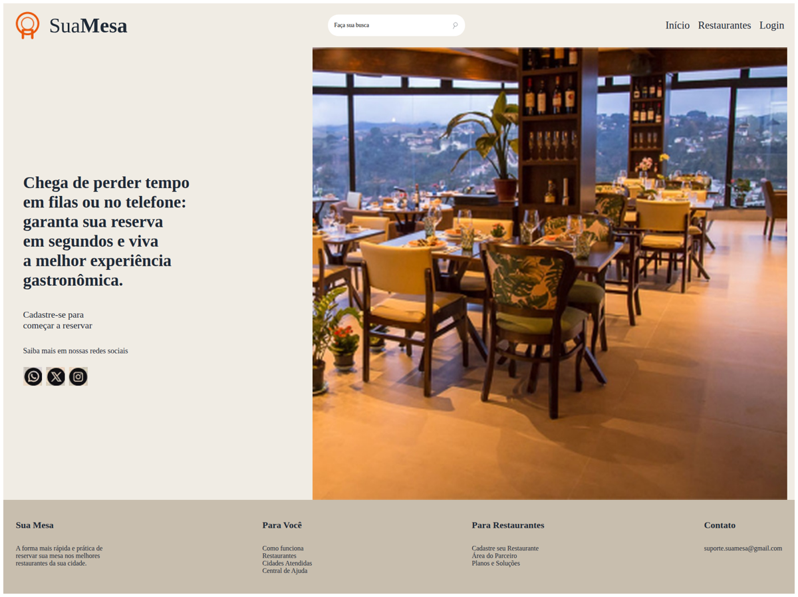
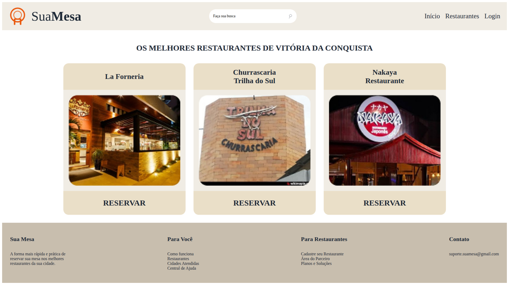
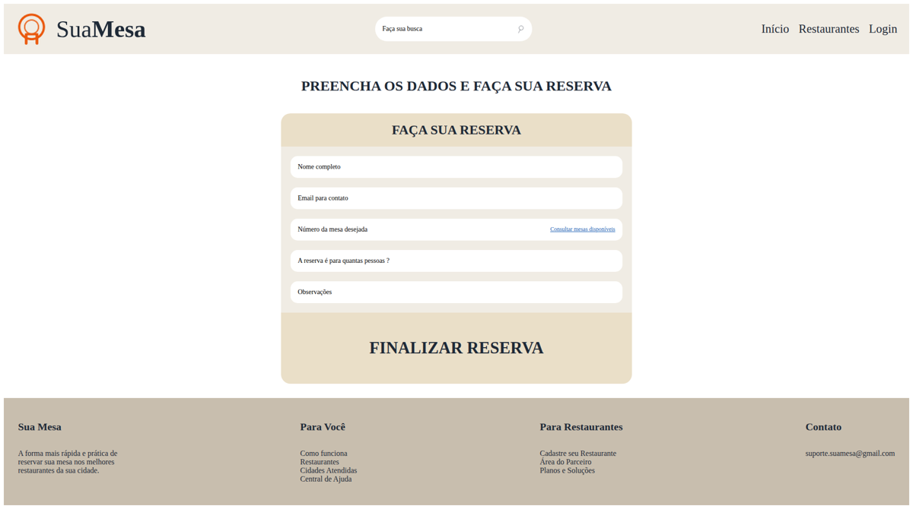
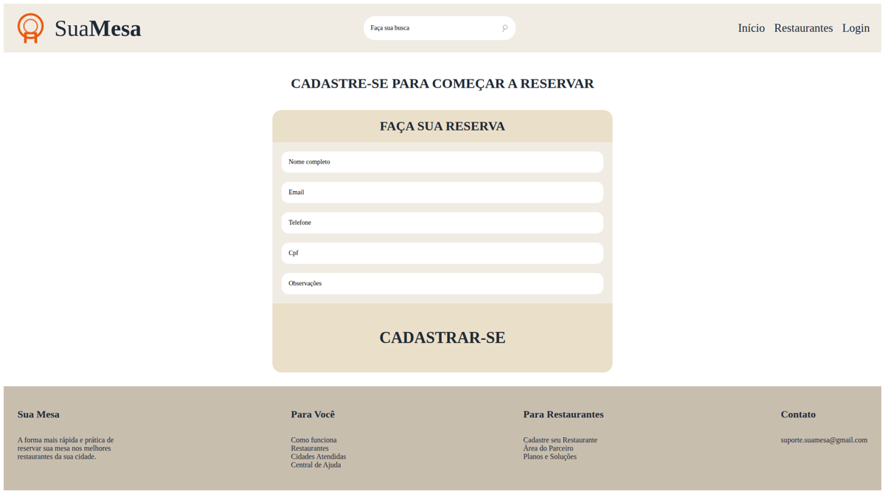

## Sua Mesa

**Identificação do Projeto**

| Campo | Informação |
| --- | --- |
| Nome | Sua Mesa |
| Integrantes | Gabriel Araújo e Guilherme Andrade |
| Curso e Turma | Informática para Internet - 2D |
| Professor | Josué |

---

## Apresentação do Projeto

- **Qual é seu projeto:** O site *Sua Mesa*
- **Objetivo:** Realizar reserva de mesas em diversos restaurantes por meio de um cadastro
- **Problema:** Resolver o problema das filas de espera em restaurantes
- **Por que foi desenvolvido:** Para virar uma forma eficiente de solucionar o problema

---

## Funcionalidades

- **Funcionalidades:** Ver lista de restaurantes, número de mesas, fazer cadastro, etc.
- **O que o usuário faz:** Reserva mesas em restaurantes a partir de um cadastro
- **Funcionalidades Desenvolvidas:** Landing Page, Cadastro, Login, Reservas

---

## Tecnologias Utilizadas

- HTML5
- CSS3

---

## Estrutura do Projeto

- Landing Page
- Restaurantes
- Reserva
- Login
- Cadastro

---

## Como executar o projeto

```Apenas abra o site, faça seu cadastro, e você já pode começar a reservar```

---

## Demonstração do Projeto









---

## Melhorias Futuras

- Cadastrar e convidar mais restaurantes para fazer parte
- Adicionar novas funções além da reserva de mesa
